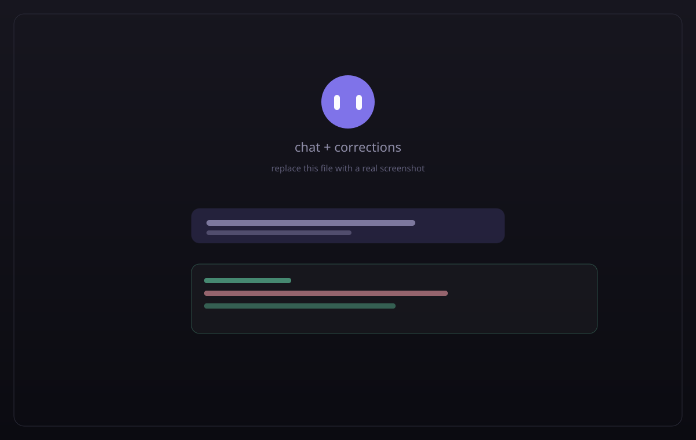
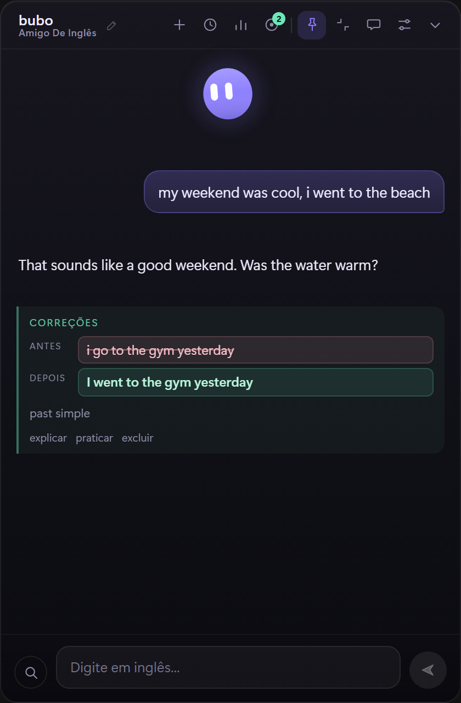
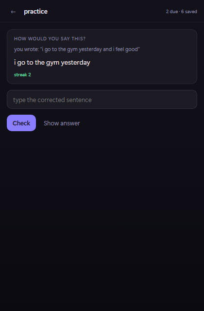
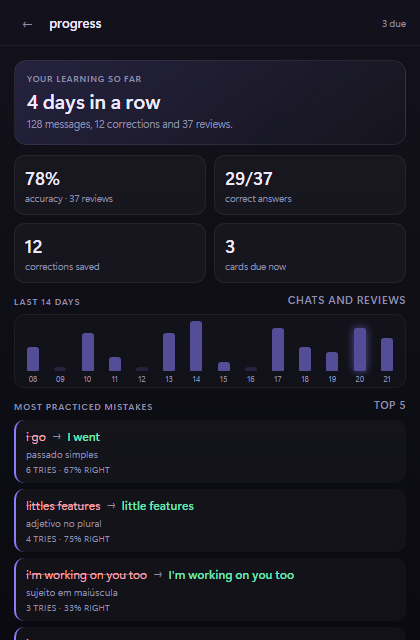
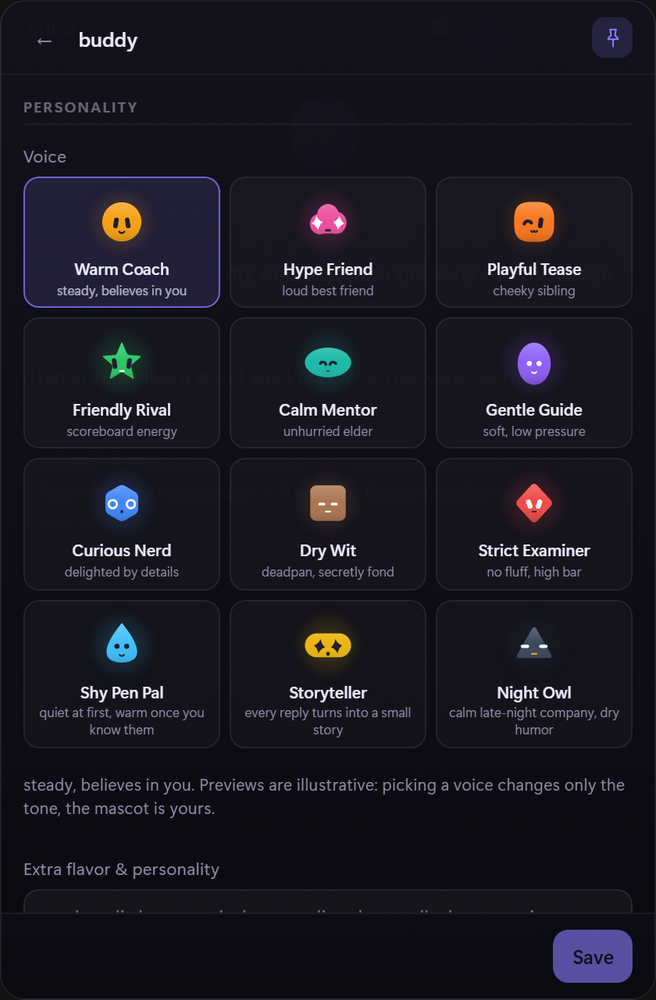
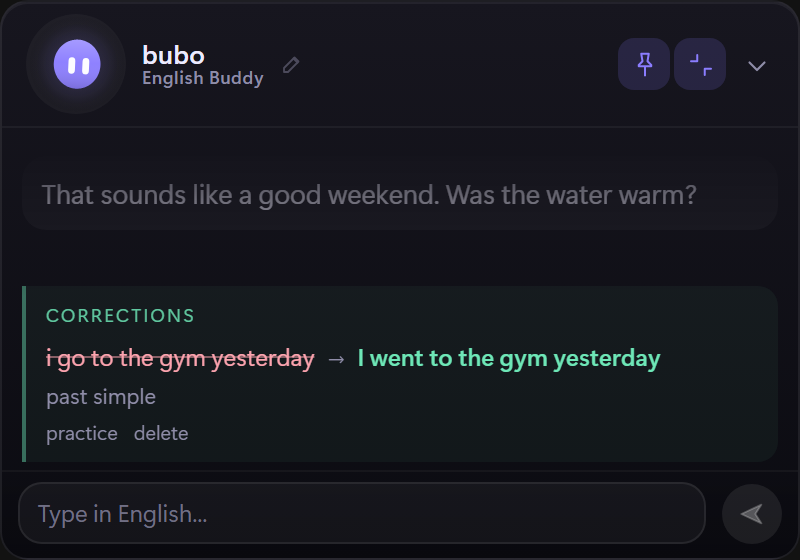
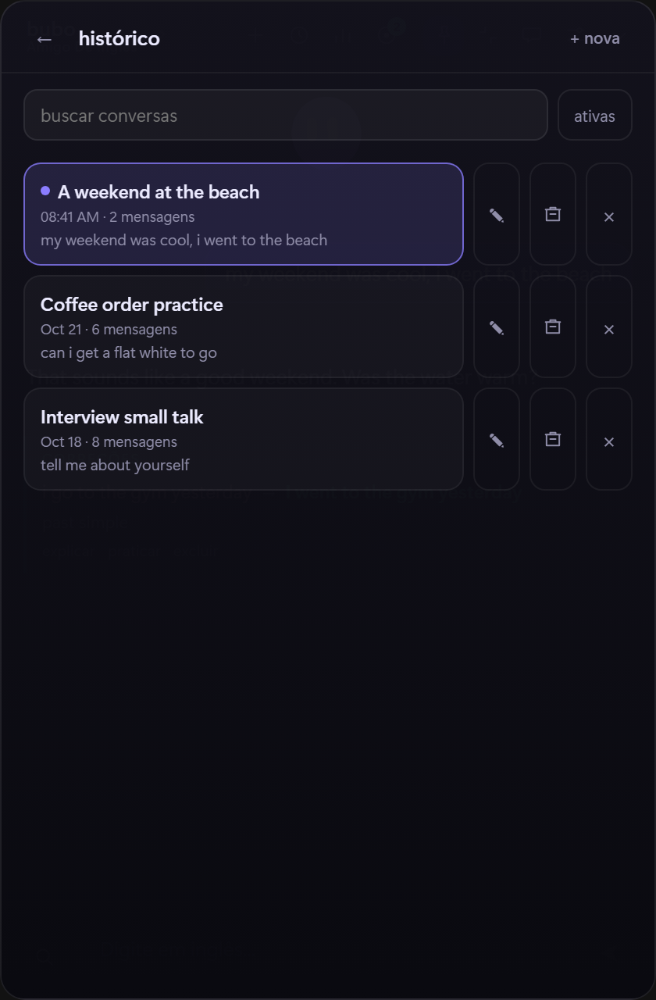

# bubo

A tiny English tutor that lives in a floating window on your desktop. You chat in English, bubo answers at your level and quietly shows what a native speaker would have said, then turns those corrections into a spaced-repetition practice deck.



<p>
  
  
  
  
</p>

## Why another language app

Because the useful part of learning a language is the five minutes between real tasks, and opening a browser tab for that never happens. bubo is a small always-on-top popup with a mascot, one hotkey away, that keeps the conversation going and remembers what you got wrong.

## Features

- **Always there, never in the way**: frameless popup, global hotkey, tray icon, pin/unpin, hides on `Esc`.
- **A mascot with a face**: 12 shapes, 9 colors plus a custom picker, 9 eye styles, eye color, spacing and tilt, plus an optional mouth with six shapes and three sizes. Spring physics, drag jelly, idle look-arounds, blinks, pointer gaze and a hop when you click it. The little mascot in the header opens its customization panel.
- **Ready-made personalities**: nine voices such as Warm Coach, Dry Wit or Hype Friend. Picking one changes only the tutor's tone; the mascot look stays exactly as you customized it. The free-text flavor field stacks on top.
- **Compact mode**: a 400 x 280 horizontal chat card with the buddy in the header, the current mood under the name and a one-line composer. The full window is one click away.
- **Bring your own endpoint**: Groq, OpenAI, OpenRouter, Ollama or any OpenAI-compatible URL, with model suggestions and a test connection button.
- **Conversation first**: replies stream token by token; a separate pass returns corrections as strict JSON, so the card never depends on the model following inline formatting.
- **Corrections that stick**: every fix is stored, linked to the message that produced it, and scheduled with a 1 / 3 / 7 / 21 / 45 day ladder. A miss comes back in ten minutes.
- **Practice mode**: rewrite the wrong sentence, get instant feedback, see the original context. Skip the due cards or reset the deck from settings.
- **Progress**: streak, accuracy, a 14-day activity strip and the mistakes you practice most, all from the local database.
- **History**: every conversation is a session. Reopen an old one, start a new one or delete one from the list.
- **Local by default**: API key in the Windows Credential Manager, history in SQLite, no telemetry, no account.
- **Recoverable**: stop a reply mid-stream, retry a failed turn, copy or delete a message.

## Screenshots

| Chat and corrections | Practice | Progress |
| --- | --- | --- |
|  |  |  |

| Buddy panel | Compact mode | History |
| --- | --- | --- |
|  |  |  |

## Install

### Windows installer

1. Download the latest `bubo_x.y.z_x64-setup.exe` from [Releases](https://github.com/LucasInstra/bubo/releases).
2. Run it. It installs per user in `%LOCALAPPDATA%\bubo`.
3. Launch **bubo** from the Start menu.

### From source

Requirements: Node 20+, Rust stable (MSVC toolchain) and Visual Studio Build Tools with the C++ workload.

```powershell
git clone https://github.com/LucasInstra/bubo.git
cd bubo
npm install
npm run tauri build     # installer in src-tauri/target/release/bundle
```

## First run

1. Settings opens automatically. Paste a Groq API key from [console.groq.com/keys](https://console.groq.com/keys). It is stored in the Windows Credential Manager.
2. Pick your CEFR level. `B1` is a good default.
3. Press `Ctrl+Alt+B` (or use the tray icon) to show bubo, and say hello.

The default model is `openai/gpt-oss-120b`. Any OpenAI-compatible base URL works if you prefer another provider.

## Keyboard

| Shortcut | Action |
| --- | --- |
| `Enter` | Send |
| `Shift+Enter` | New line |
| `Esc` | Close settings/practice, otherwise hide the window |
| `Ctrl+Alt+B` | Show/hide bubo (configurable in settings) |

## Customize

- Mascot: shape, color (including picker), eyes, size, mouth, status label.
- App: accent color follows the mascot, message text size, always-on-top, start with Windows.
- Learning: level, ignore capitalization for informal chat, persona.
- Connection: API key, model, base URL.

## How it works

```
┌──────────────┐   stream    ┌──────────────┐
│  React UI    │◀────────────│              │
│  (WebView)   │   deltas    │  Rust core   │──▶ provider (OpenAI-compatible)
│              │────────────▶│              │
└──────────────┘   invoke    └──────┬───────┘
                                    │
                          SQLite (messages, fixes)
```

1. **Reply pass**: streamed SSE from the provider, forwarded to the UI as `bubo-delta` events.
2. **Correction pass**: a second, non-streamed call that returns `[{wrong, right, note}]` and is stored on the message row.
3. **Practice queue**: each fix is deduplicated and scheduled; the drill reads the next due card and updates its interval.
4. **Persistence**: the reply is saved before corrections run, so quitting mid-flight never leaves an orphan turn.

## Data and privacy

| What | Where |
| --- | --- |
| API key | Windows Credential Manager (`bubo` / `llm-api-key`) |
| History and fixes | `%APPDATA%\com.lucas.bubo\bubo.db` |
| Settings | `%APPDATA%\com.lucas.bubo\settings.json` |
| Diagnostics | `%APPDATA%\com.lucas.bubo\bubo.log` (rotated, 1 MB cap) |

Only the text you send is forwarded to your provider. There is no analytics and no third-party service besides the model endpoint you configure.

## Development

```powershell
npm install
npm run tauri dev       # hot-reload window
npm run test:unit       # frontend tests (Vitest)
npm run test:e2e        # Playwright against the web UI with mocked IPC
npm run lint            # ESLint
npm run format:check    # Prettier
cargo test --manifest-path src-tauri/Cargo.toml
cargo clippy --manifest-path src-tauri/Cargo.toml --all-targets -- -D warnings
npm run tauri build     # release installer
```

The webview runs with a Content Security Policy defined in `src-tauri/tauri.conf.json`. The E2E suite drives the real React UI through a small harness that mocks the Tauri IPC bridge.

### Project structure

```
src/                      React UI
  components/Mascot.tsx   canvas mascot (face, gaze, drag, states)
  components/Drill.tsx    practice flow
  components/BuddyPanel.tsx    voice + look customization
  components/ProgressPanel.tsx streak, accuracy, activity
  components/HistoryPanel.tsx  session list
  components/SettingsPanel.tsx app settings
  lib/ipc.ts              typed bridge to Rust
src-tauri/src/
  lib.rs                  window, tray, hotkey, commands
  llm.rs                  streaming, retries, JSON parsing
  prompt.rs               tutor and correction prompts
  store.rs                SQLite: sessions, messages, fixes, reviews
  config.rs               settings + credential storage
  log.rs                  rotating diagnostics
e2e/                      Playwright harness and tests
```

## Troubleshooting

- **`401`/`invalid api key`**: paste the key again in Settings → Connection. Keys start with `gsk_`.
- **Hotkey does nothing**: another app may own the combination. Pick a different one in Settings → Behavior; the app keeps working if registration fails and logs it.
- **Strange answer or empty reply**: check `%APPDATA%\com.lucas.bubo\bubo.log` for the request and error lines.
- **Practice looks empty**: corrections only appear after a message with a real mistake. The target icon shows how many cards are due.

## Roadmap

- Search and rename old sessions.
- Per-message "practice this" on the correction card.
- Tighter Content Security Policy for the webview.
- Voice practice (speak and listen), later, deliberately.

## License

No license yet. Ask before redistributing.
