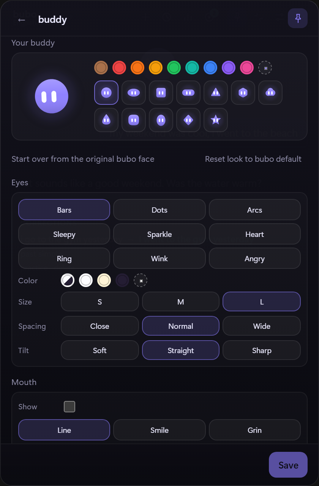

# bubo

A tiny English tutor that lives in a floating window on your desktop. You chat in English, bubo answers at your level and quietly shows what a native speaker would have said, then turns those corrections into a spaced-repetition practice deck.

Website: https://lucasinstra.github.io/bubo/

<p align="center">
  <a href="docs/assets/bubo.png"></a>
</p>

[](docs/screenshots/chat.png)

<p>
  
  
  
  
  <a href="https://github.com/LucasInstra/bubo/actions/workflows/ci.yml"></a>
</p>

## Why another language app

Because the useful part of learning a language is the five minutes between real tasks, and opening a browser tab for that never happens. bubo is a small always-on-top popup with a mascot, one hotkey away, that keeps the conversation going and remembers what you got wrong.

## Features

- **Always there, never in the way**: frameless popup, global hotkey, tray icon, pin/unpin, hides on `Esc`.
- **A mascot with a face**: 12 shapes, 9 colors plus a custom picker, 9 eye styles, eye color, spacing and tilt, plus an optional mouth with six shapes and three sizes. Spring physics, drag jelly, idle look-arounds, blinks, pointer gaze and a hop when you click it. The little mascot in the header opens its customization panel.
- **Ready-made personalities**: twelve voices such as Warm Coach, Dry Wit or Hype Friend. Picking one changes only the tutor's tone; the mascot look stays exactly as you customized it. The free-text flavor field stacks on top.
- **Compact mode**: a 400 x 280 horizontal chat card with the buddy in the header, the current mood under the name and a one-line composer. The full window is one click away.
- **Setup without jargon**: the first launch explains what an API key is, walks through a free Groq key with a numbered tutorial, recognizes pasted Groq, OpenAI and OpenRouter keys, and offers a no-key Ollama path for a local model.
- **Bring your own endpoint**: Groq, OpenAI, OpenRouter, Ollama or any OpenAI-compatible URL, with model suggestions, a test connection button, optional proxy and custom CA certificate for company networks.
- **Conversation first**: replies stream token by token; a separate pass returns corrections as strict JSON, so the card never depends on the model following inline formatting. Replies render Markdown, and a search field filters the current conversation. bubo can reply in English only, in Portuguese with the English version behind a “ver em inglês” button, or in Portuguese only when you are still learning to read English.
- **Beginner mode (A1/A2)**: in bilingual replies the Portuguese comes first and the English waits behind a button, bubo gives a small hint before the full answer, and you can choose a study focus (to be, past simple, questions and more) or work through ten short grammar lessons from A1 to B2 with one exercise per step.
- **Looks and pace**: dark, light or system theme; a daily review goal; an optional daily reminder notification when cards are due.
- **Corrections that stick**: every fix is stored, linked to the message that produced it, and scheduled with a 1 / 3 / 7 / 21 / 45 day ladder. A miss comes back in ten minutes.
- **Practice mode**: rewrite the wrong sentence, get instant feedback, see the original context, and use “I was right” when a valid alternative was marked wrong. Skip the due cards or reset the deck from settings.
- **Progress**: streak, accuracy, a 14-day activity strip and the mistakes you practice most, all from the local database.
- **History**: every conversation is a session. Search, rename, archive, reopen, start a new one or delete one from the list.
- **Backups and diagnostics**: export the SQLite database to a file, restore it later, open the data folder or copy a diagnostics report from Settings.
- **Local by default**: API key in the Windows Credential Manager, history in SQLite, no telemetry, no account.
- **Recoverable**: stop a reply mid-stream, retry a failed turn, copy or delete a message.

## Screenshots

| Chat and corrections                                            | Practice                                                                    | Progress                                                                    |
| --------------------------------------------------------------- | --------------------------------------------------------------------------- | --------------------------------------------------------------------------- |
| [](docs/screenshots/chat.png) | [](docs/screenshots/practice.png) | [](docs/screenshots/progress.png) |

| Buddy panel                                                              | Compact mode                                                                  | History                                                                  |
| ------------------------------------------------------------------------ | ----------------------------------------------------------------------------- | ------------------------------------------------------------------------ |
| [](docs/screenshots/buddy.png) | [](docs/screenshots/compact.png) | [](docs/screenshots/history.png) |

### Customization

[](docs/screenshots/look.png)

The default bubo is purple, round, with bars eyes, size L, straight tilt and no mouth. The **Reset look** button restores it, and every part stays editable.

## Install

### Windows installer

1. Download the latest `bubo_x.y.z_x64-setup.exe` from [Releases](https://github.com/LucasInstra/bubo/releases).
2. Run it. It installs per user in `%LOCALAPPDATA%\bubo`.
3. Launch **bubo** from the Start menu.

### Portable and ARM64

Each release also gets `bubo-portable-x64.zip` (the executable alone). The
ARM64 bundles are produced manually from the **ARM64 build** GitHub workflow;
they are not part of the x64 release assets.

### From source

Requirements: Node 20+, Rust stable (MSVC toolchain) and Visual Studio Build Tools with the C++ workload.

```powershell
git clone https://github.com/LucasInstra/bubo.git
cd bubo
npm install
npm run tauri build     # installer in src-tauri/target/release/bundle
```

Updater artifacts are enabled, so a local installer build also needs `TAURI_SIGNING_PRIVATE_KEY` and `TAURI_SIGNING_PRIVATE_KEY_PASSWORD`. The release workflow supplies them from GitHub secrets.

## First run

1. The setup screen opens on the first launch. Choose **Groq** for a free key with a numbered tutorial, **Já tenho uma chave** to paste an existing Groq, OpenAI or OpenRouter key, or **Rodar no PC** to use Ollama without any key. Keys are stored in the Windows Credential Manager.
2. Pick your CEFR level. `B1` is a good default. Then choose the reply language: English only, Portuguese with the English behind a button, or Portuguese only if you cannot read English yet. At A1/A2, bubo also offers a translation challenge, a study focus and ten mini-lessons from A1 to B2.
3. Press `Ctrl+Alt+B` (or use the tray icon) to show bubo, and say hello.

The default model is `openai/gpt-oss-120b`. Any OpenAI-compatible base URL works if you prefer another provider.

## Updates

bubo checks GitHub Releases when it starts and shows a small banner when a newer version exists. When you are not in the middle of a reply, the mascot also speaks up with the new version and the install shortcut. There is also a manual check under Settings → Updates.

Updates are matched by version and by build. A new version always wins; the same version is only offered when its build is higher, so a fix build can be published without a new version and still reach installations that already have that version. The build number is `BUILD_NUMBER` in `src/lib/build.ts` and is also written to `latest.json` by `scripts/updater-json.mjs`.

The build is unsigned, so Windows SmartScreen may still warn on first run; update packages are verified with the Tauri updater signing key instead of an Authenticode certificate.

The first updater-enabled release must be installed by hand. After that, later versions can download and install from inside the app.

## Releasing

1. Write `release-notes/<version>.md` in English. The release workflow uses this file as the GitHub release body. Add `release-notes/<version>.pt.md` with the Portuguese highlights for the app's Updates tab; the updater manifest carries it as `notes_pt`.
2. Start from a clean tree and run `npm version patch` (or `minor` / `major`). The `version` script syncs the new version into `src-tauri/Cargo.toml`, `src-tauri/tauri.conf.json` and `src-tauri/Cargo.lock`, resets `BUILD_NUMBER` to 1, stages those files, and npm commits and tags the release.
3. Push the commit and the tag with `git push origin main --follow-tags`.
4. The release workflow builds on Windows and publishes the installer, the updater artifacts and `latest.json` (including the build number) to GitHub Releases.

### Fix builds

A single fix does not get a new version or tag. Bump `BUILD_NUMBER` in `src/lib/build.ts` by hand, add `release-notes/<version>.build<N>.md` and `.pt.md` describing exactly what changed in that build, commit both, and run the **Fix build** workflow from Actions with the current release tag. It builds the NSIS installer with the same version, replaces the stable `bubo-setup.exe` asset, the versioned installer and its signature, and regenerates `latest.json` from the build notes, so the update card and the public release body say what changed in that build. The workflow refuses to run when either build-notes file is missing.

## Keyboard

| Shortcut      | Action                                             |
| ------------- | -------------------------------------------------- |
| `Enter`       | Send                                               |
| `Shift+Enter` | New line                                           |
| `Esc`         | Close settings/practice, otherwise hide the window |
| `Ctrl+Alt+B`  | Show/hide bubo (configurable in settings)          |

## Customize

- Mascot: shape, color (including picker), eyes, size, mouth, status label.
- App: accent color follows the mascot, message text size, always-on-top, start with Windows.
- Learning: level, reply language, beginner translation challenge and study focus (A1/A2), ignore capitalization for informal chat, persona.
- Connection: API key, model, base URL.

## How it works

```
┌──────────────┐   stream    ┌──────────────┐
│  React UI    │◀────────────│              │
│  (WebView)   │   deltas    │  Rust core   │──▶ provider (OpenAI-compatible)
│              │────────────▶│              │
└──────────────┘   invoke    └──────┬───────┘
                                    │
                          SQLite (messages, fixes)
```

1. **Reply pass**: streamed SSE from the provider, forwarded to the UI as `bubo-delta` events.
2. **Correction pass**: a second, non-streamed call that returns `[{wrong, right, note}]` and is stored on the message row.
3. **Practice queue**: each fix is deduplicated and scheduled; the drill reads the next due card and updates its interval.
4. **Persistence**: the reply is saved before corrections run, so quitting mid-flight never leaves an orphan turn.

## Data and privacy

| What              | Where                                                   |
| ----------------- | ------------------------------------------------------- |
| API key           | Windows Credential Manager (`bubo` / `llm-api-key`)     |
| History, fixes and lesson progress | `%APPDATA%\bubo\bubo.db`                      |
| Settings          | `%APPDATA%\bubo\settings.json`                |
| Diagnostics       | `%APPDATA%\bubo\bubo.log` (rotated, 1 MB cap) |

Only the text you send is forwarded to your provider. There is no analytics and no third-party service besides the model endpoint you configure.

## Distribution

```powershell
npm run tauri build     # NSIS and MSI in src-tauri/target/release/bundle
npm run portable        # bubo-portable-x64.zip beside the release executable
```

Winget manifests are generated after a release; see `winget/README.md`.

## Development

```powershell
npm install
npm run tauri dev       # hot-reload window
npm run test:unit       # frontend tests (Vitest)
npm run test:e2e        # Playwright against the web UI with mocked IPC
npm run lint            # ESLint
npm run format:check    # Prettier
npm run version:check   # package.json, Cargo and tauri.conf.json in sync
cargo test --manifest-path src-tauri/Cargo.toml
cargo clippy --manifest-path src-tauri/Cargo.toml --all-targets -- -D warnings
npm run tauri build     # release installer
```

The webview runs with a Content Security Policy defined in `src-tauri/tauri.conf.json`. The E2E suite drives the real React UI through a small harness that mocks the Tauri IPC bridge.

### Project structure

```
src/                      React UI
  components/Mascot.tsx   canvas mascot (face, gaze, drag, states)
  components/Drill.tsx    practice flow
  components/BuddyPanel.tsx    voice + look customization
  components/ProgressPanel.tsx streak, accuracy, activity
  components/HistoryPanel.tsx  session list
  components/SettingsPanel.tsx app settings
  lib/ipc.ts              typed bridge to Rust
src-tauri/src/
  lib.rs                  window, tray, hotkey, commands
  llm.rs                  streaming, retries, JSON parsing
  prompt.rs               tutor and correction prompts
  store.rs                SQLite: sessions, messages, fixes, reviews
  config.rs               settings + credential storage
  log.rs                  rotating diagnostics
e2e/                      Playwright harness and tests
```

## Troubleshooting

- **`401`/`invalid api key`**: paste the key again in Settings → Connection. Keys start with `gsk_`.
- **Hotkey does nothing**: another app may own the combination. Pick a different one in Settings → Behavior; the app keeps working if registration fails and logs it.
- **Strange answer or empty reply**: check `%APPDATA%\bubo\bubo.log` for the request and error lines.
- **Practice looks empty**: corrections only appear after a message with a real mistake. The target icon shows how many cards are due.

## Roadmap

- Manual correction add/edit when the model misses or mislabels a fix.
- Content Security Policy without inline styles.
- Authenticode signing for the installer.
- Voice practice (speak and listen), later, deliberately.

## License

bubo is currently **all rights reserved**. See [LICENSE](LICENSE) for the full terms. The source is public for reference and evaluation, and no permission is granted to reuse it without prior written permission. These terms may change later; a permissive license such as MIT could replace them in a future release.
